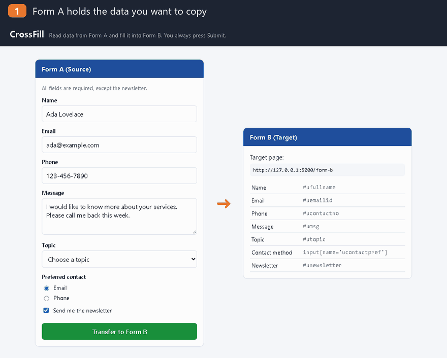
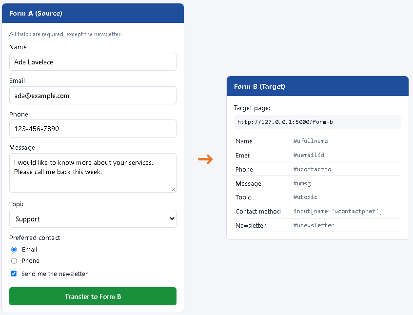
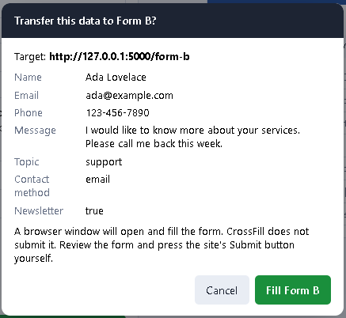
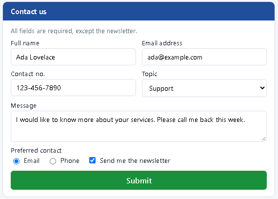
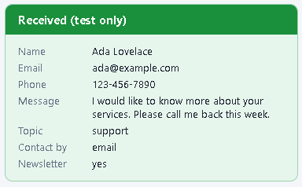

# CrossFill

**Copy data from one web application into another's form, with automatic field matching. A human always presses Submit.**

[](https://github.com/singhharvendra/CrossFill/actions/workflows/python.yml)
[](https://github.com/singhharvendra/CrossFill/actions/workflows/dotnet.yml)
[](LICENSE)

Many teams still re-type the same record from one system into another
because the systems have no API between them. Clinics copy patients into an
insurer's portal, NGOs copy beneficiaries into a government form, and
recruiters copy candidates into a client's ATS. This "swivel-chair" data entry
is slow, and every manual copy can introduce a typo.

CrossFill automates the copying but leaves the decision to a person. It
reads a record (from a web page, JSON or CSV), opens the target form, finds
the matching fields, fills them, **reads every value back to verify it**,
and stops. You review the form and press Submit yourself.



## Choose your implementation

CrossFill comes in two versions that behave the same way. They read the same
mapping files, take the same command-line options, give the same results and
serve the same demo. Pick whichever fits your stack.

| | **Python** | **.NET** |
|---|---|---|
| Folder | [`python/`](python) | [`dotnet/`](dotnet) |
| Requires | Python 3.9+ | .NET 11 |
| Command line | `crossfill` | `crossfill` |
| Library | `pip install crossfill` | `dotnet add package CrossFill` |
| Demo web app | Flask | ASP.NET |

Both are tested against the same shared [conformance cases](spec/conformance/cases.json),
so a mapping that works with one works with the other.

## Quick start

**Python**

```bash
pip install "crossfill[web]"
crossfill serve                     # then open http://127.0.0.1:5000
```

**.NET**

```bash
dotnet tool install --global CrossFill.Cli
crossfill playwright install chromium
crossfill serve                     # then open http://127.0.0.1:5000
```

Form A is already filled with sample data. Choose a **Topic**, click **Transfer to Form B** and
watch it fill in. On Windows, you can instead double-click `python/run.bat` or `dotnet/run.bat`,
which does all of this for you. See the [demo walkthrough](#demo-walkthrough) for screenshots of
each step.

Free to use for anything: no permission or credit needed ([MIT-0](LICENSE)).

## Features

- **Mapping as code.** Describe a target form once in a small,
  [schema-checked](spec/schema/mapping.schema.json) JSON file, then review
  it and keep it under version control. The same file works with both implementations.
- **Automatic field matching.** Fields without a selector are found from
  their name, id, placeholder, aria-label and `<label>` text. You can add
  your own synonyms per mapping.
- **Type-aware filling.** Handles text, textarea, `<select>` (by value or
  visible label), checkboxes and radio groups.
- **Verification.** Every value is read back. Reformatted or rejected values are
  reported as `mismatched`, not ignored.
- **Scoped.** Only the form matched by `form_selector` is touched. Hidden
  login and registration pop-ups are ignored.
- **Dry run.** `--dry-run` shows which element each field would go to,
  without typing anything.
- **Private by default.** Logs never contain field values. The demo server is
  limited to localhost.
- **Three interfaces:** a CLI, a library (Python or .NET), and a local web UI.

## Install

### Python

Requires Python 3.9+.

```bash
pip install "crossfill[web]"       # or: pip install crossfill  (CLI and library only)
playwright install chromium        # optional: falls back to installed Chrome or Edge
```

From source:

```bash
git clone https://github.com/singhharvendra/CrossFill.git && cd CrossFill/python
pip install -e ".[web]"
```

### .NET

Requires the .NET 11 SDK (or the .NET 11 ASP.NET runtime for the tool alone).

```bash
dotnet tool install --global CrossFill.Cli     # the crossfill command
crossfill playwright install chromium          # optional: falls back to installed Chrome or Edge
dotnet add package CrossFill                   # the library, for your own app
```

From source:

```bash
git clone https://github.com/singhharvendra/CrossFill.git && cd CrossFill/dotnet
dotnet build
dotnet run --project src/CrossFill.Cli -- serve
```

On Windows you can double-click `python/run.bat` or `dotnet/run.bat`, which
sets everything up and opens the demo.

## Demo walkthrough

The demo runs entirely on your own computer. It has two forms:

- **Form A**, the *source*: where your data comes from.
- **Form B**, the *target*: a local test form that CrossFill fills in for you.

Start it with:

```bash
crossfill serve                     # then open http://127.0.0.1:5000
```

The steps and screens below are the same for both implementations.

### Step 1: Check the data in Form A

Form A opens with sample data already filled in, so you can try CrossFill
straight away. It includes every kind of field CrossFill handles: text boxes,
a message box, a dropdown, radio buttons and a checkbox. The right-hand panel
shows which Form B field each value will go to.

Every field is required except the newsletter. Choose a **Topic**, change
anything else you like, then click **Transfer to Form B**.



### Step 2: Confirm the transfer

CrossFill shows exactly what it is about to copy and where it will go.
Click **Fill Form B** to continue, or **Cancel** to stop.



### Step 3: Review the filled Form B

A browser window opens Form B and fills every field: text, dropdown, radio
button and checkbox. CrossFill reads each value back to check it. Then it
**stops**: it never presses Submit.

Look over the form, fix anything you want, and press **Submit** yourself.



### Step 4: See what Form B received

After you press Submit, the test Form B shows what it received. This is a
local test form, so the data stays in memory on your computer and is not
sent anywhere.



### What happened behind the scenes

```
Form A  ──►  read every field  ──►  match each field  ──►  fill Form B  ──►  read back  ──►  you press Submit
(source)     (text, dropdown,       to a Form B field      (by field type)   and verify
              radio, checkbox)      (mapping file or
                                     automatic matching)
```

The links between Form A and Form B fields come from a small mapping file,
[`spec/mappings/form_b.json`](spec/mappings/form_b.json). To use
CrossFill with your own website, copy that file and change the field
selectors. See [Mapping file](#mapping-file) below.

## Command line

The `crossfill` command is the same in both implementations.

```bash
# From a JSON or CSV record (row 1 = second data row)
crossfill run --data examples/data/contacts.csv --record 1 --mapping my-site.json --keep-open

# From a source web page
crossfill run --source-url "https://crm.example/record/42" --mapping my-site.json

# See the plan without typing anything
crossfill run --data examples/data/record.json --mapping my-site.json --dry-run --headless

# Check mapping files (great in CI or a pre-commit hook)
crossfill validate my-site.json examples/mappings/*.json
```

| Option | Meaning |
|--------|---------|
| `--source-url URL` / `--data FILE` | Where the record comes from (`.json` object or list, or `.csv`) |
| `--record N` | Which record in `--data` to use (0-based) |
| `--mapping FILE` | Target mapping (default: bundled local test Form B) |
| `--target-url URL` | Override the mapping's `target_url` (also `CROSSFILL_TARGET_URL`) |
| `--dry-run` | Match and report only |
| `--keep-open` | Leave the browser open for review |
| `--headless` | No visible window (also `CROSSFILL_HEADLESS=1`) |
| `-v` | Log each step (field names and selectors only) |

Exit codes: `0` all fields filled and verified · `1` incomplete or failed · `2`
bad arguments, mapping or data file. The CLI also prints one
`CROSSFILL_RESULT {json}` line for scripts.

The .NET tool has one extra command, `crossfill playwright ...`, which runs
Playwright's own tool (for example `crossfill playwright install chromium`).
Python users get the same thing from the `playwright` command.

## Library

**Python**

```python
from crossfill import load_mapping, load_records, run_transfer

mapping = load_mapping("my-site.json")
for record in load_records("contacts.csv"):
    result = run_transfer(mapping=mapping, data=record, keep_open=True)
    print(result.summary())     # you review and submit each one, then close the window
```

**.NET**

```csharp
using CrossFill;

var mapping = MappingLoader.Load("my-site.json");
foreach (var record in Sources.LoadRecords("contacts.csv"))
{
    var result = await Engine.RunTransferAsync(mapping: mapping, data: record, keepOpen: true);
    Console.WriteLine(result.Summary());   // you review and submit each one, then close the window
}
```

Both return a `TransferResult` with `ok`, `filled` (field → selector),
`verified` (field → value now in the form), `unmatched`, `mismatched`,
`skipped` and `error` (`Ok`, `Filled`, ... in .NET).

## Mapping file

```json
{
  "$schema": "https://raw.githubusercontent.com/singhharvendra/CrossFill/main/spec/schema/mapping.schema.json",
  "version": 1,
  "name": "Partner contact form",
  "target_url": "https://partner.example/contact",
  "form_selector": "form#contact",
  "fields": {
    "name": "#ufullname",
    "email": "#uemailid",
    "topic": "select#subject",
    "newsletter": "input[name='optin']"
  },
  "synonyms": { "message": ["how can we help"] }
}
```

Leave `fields` empty (`{}`) to rely fully on automatic matching. To support a
new site, copy [`examples/mappings/template.json`](examples/mappings/template.json),
then run `crossfill validate` and a `--dry-run`. The full format is in
**[docs/mapping-reference.md](docs/mapping-reference.md)**.

## How it compares

| | Browser autofill | General RPA suites | **CrossFill** |
|---|---|---|---|
| Data from another app or a file | No (only your profile) | Yes | Yes |
| Site knowledge stored as | — | Recorded GUI flows | Reviewable JSON with a schema |
| Copes with changed selectors | — | Re-record | Automatic matching fallback |
| Verifies every value | No | Varies | Yes |
| Submits for you | — | Usually | **Never, by design** |
| Cost / footprint | Free | Commercial, heavy | Free (MIT-0), one `pip install` or `dotnet tool install` |

## Responsible use

CrossFill is built to help people with their own data entry, and it is
deliberately not a bot.

- Only automate forms you are allowed to use, and follow each site's terms.
- CrossFill never clicks Submit. It does not solve CAPTCHAs or evade bot
  detection, and it will not send bulk or unsolicited submissions. These are
  firm project boundaries, not missing features.

## Documentation

- [Mapping reference](docs/mapping-reference.md)
- [Architecture, design principles and how the two implementations stay in step](docs/architecture.md)
- [Contributing](CONTRIBUTING.md) · [Security policy](SECURITY.md) · [Changelog](CHANGELOG.md)

## Roadmap

- Multi-page and wizard forms (`steps` in the mapping)
- Field transforms (split full name, date formats, phone normalisation)
- Batch review queue in the web UI: step through a CSV one record at a time
- Browser extension front end
- A community library of mappings for common open-source apps (CRMs, ticketing, HR)

Ideas and votes are welcome in the issues.

## Project layout

```
spec/                    # shared by both implementations
├── schema/              # JSON Schema for mapping files
├── mappings/            # bundled sample mapping (local test Form B)
└── conformance/         # behaviour cases both test suites must pass
examples/                # sample mappings and data
docs/                    # reference and architecture

python/
├── crossfill/
│   ├── cli.py           # crossfill run / validate / serve
│   ├── engine.py        # open target → two-pass match → type-aware fill → verify
│   ├── matcher.py       # synonym scoring (pure) + candidate collection
│   ├── mapping.py       # load + validate mapping files
│   ├── sources.py       # web page, JSON and CSV records
│   └── web/             # optional demo app (Flask): Form A, test Form B
├── tests/               # unit, web, end-to-end and conformance tests
└── sync_spec.py         # copies spec/ files into the package

dotnet/
├── src/
│   ├── CrossFill/       # Mapping, Matcher, Sources, Engine (the library)
│   ├── CrossFill.Web/   # demo app (ASP.NET + Razor): Form A, test Form B
│   └── CrossFill.Cli/   # the crossfill tool
└── tests/CrossFill.Tests/   # unit, web, end-to-end and conformance tests
```

## Tests

Browser tests use only the local test Form B.

```bash
# Python
cd python
pip install -e ".[dev]" && playwright install chromium
pytest -m "not browser"    # fast, no browser
pytest                     # everything

# .NET
cd dotnet
dotnet build
dotnet test --filter "Category!=browser"    # fast, no browser
dotnet test                                 # everything
```

## License and reuse

[MIT No Attribution (MIT-0)](LICENSE). Use, copy, change, sell or build on
CrossFill however you like. You don't need to ask permission, credit the
project or keep the license notice.
