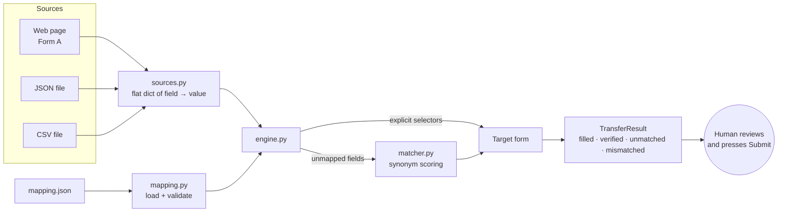

# Architecture

CrossFill is a small, layered Python package. Each layer can be used on its own.



| Module | Responsibility | Needs a browser? |
|--------|----------------|------------------|
| `crossfill/mapping.py` | Load, validate and default mapping files; env/CLI target override | no |
| `crossfill/sources.py` | Read records from a web page, JSON or CSV into `dict[str, str]` | only for web pages |
| `crossfill/matcher.py` | Score candidate elements against field synonyms (pure function) plus the JS that lists candidates | scoring: no |
| `crossfill/engine.py` | Drive Playwright: open the target, two-pass matching, type-aware fill, read-back verification | yes |
| `crossfill/cli.py` | `crossfill run / validate / serve`, exit codes, result line | — |
| `crossfill/web/` | Optional local demo (Flask): Form A, a test Form B, `/api/transfer` | — |

## Design principles

1. **Human in the loop.** CrossFill fills and verifies but never submits. There
   is no code path that clicks a submit button, and the test suite checks
   that the target receives nothing.
2. **Scoped and predictable.** Only elements inside `form_selector` are
   touched. Explicit selectors are honoured first and claim their elements,
   so auto-matching can never overwrite them.
3. **Verify, don't assume.** Every filled value is read back. Differences are
   reported as `mismatched` rather than hidden.
4. **Private by default.** Logs contain field names and selectors, never
   values. The demo server binds to `127.0.0.1` and rejects non-loopback
   `Host` headers (DNS-rebinding protection).
5. **Mapping as code.** Site knowledge lives in reviewable, schema-checked
   JSON, not in Python, so non-programmers can add support for a new site.

## Two-pass matching

```
pass 1  for each field with a selector that exists in the form:
          claim the element (data-crossfill-filled attribute)
pass 2  for each remaining field:
          score all visible, enabled, unclaimed inputs → best one or "unmatched"
fill    each planned (field, element) by element type; read back; compare
clean   remove the bookkeeping attribute
```

## Testing

* `tests/test_unit.py` — mapping validation, matcher scoring, data files, CLI. No browser.
* `tests/test_web.py` — demo app routes and security guards.
* `tests/test_e2e.py` (`-m browser`) — real headless Chromium against the
  bundled test Form B on a random local port. Nothing leaves the machine.
