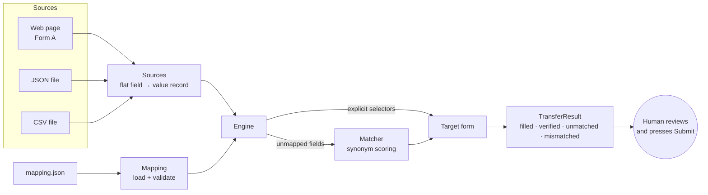

# Architecture

CrossFill has two implementations with the same behaviour: a **Python** package
([`python/`](../python)) and a **.NET** solution ([`dotnet/`](../dotnet)). Both
read the same mapping files, accept the same command-line options, print the
same result line and serve the same demo pages. Each is built from the same
small layers, and each layer can be used on its own.



| Layer | Python | .NET | Responsibility | Needs a browser? |
|-------|--------|------|----------------|------------------|
| Mapping | `crossfill/mapping.py` | `CrossFill/Mapping.cs` | Load, validate and default mapping files; env/CLI target override | no |
| Sources | `crossfill/sources.py` | `CrossFill/Sources.cs` | Read records from a web page, JSON or CSV into a flat string record | only for web pages |
| Matcher | `crossfill/matcher.py` | `CrossFill/Matcher.cs` | Score candidate elements against field synonyms (pure function) plus the JS that lists candidates | scoring: no |
| Engine | `crossfill/engine.py` | `CrossFill/Engine.cs` | Drive Playwright: open the target, two-pass matching, type-aware fill, read-back verification | yes |
| CLI | `crossfill/cli.py` | `CrossFill.Cli/Cli.cs` | `crossfill run / validate / serve`, exit codes, result line | — |
| Demo app | `crossfill/web/` (Flask) | `CrossFill.Web/` (ASP.NET) | Local demo: Form A, a test Form B, `/api/transfer` | — |

## Repository layout

```
spec/          shared by both implementations (the single source of truth)
├── schema/        JSON Schema for mapping files
├── mappings/      bundled sample mapping (local test Form B)
└── conformance/   behaviour cases both test suites run, plus their data files
examples/      sample mappings and data, used by both
python/        Python package, tests, run.bat
dotnet/        .NET solution: CrossFill, CrossFill.Web, CrossFill.Cli, tests, run.bat
docs/          this documentation
```

The .NET projects link the files in `spec/` directly. Python packaging cannot
include files from outside `python/`, so the package keeps copies; run
`python python/sync_spec.py` after changing `spec/`, and the Python tests fail
if the copies drift.

## Keeping the two implementations identical

* **Conformance cases.** [`spec/conformance/cases.json`](../spec/conformance/cases.json)
  lists inputs and expected outputs for mapping validation (including the exact
  error messages), synonym lists, match scores, candidate choice, data-file
  parsing and the demo forms' validation. `python/tests/test_conformance.py`
  and `dotnet/tests/CrossFill.Tests/ConformanceTests.cs` both run every case.
* **Mirrored tests.** The unit, web and end-to-end tests exist in both
  languages with the same names and assertions.
* **One version number.** `python/crossfill/__init__.py` and
  `dotnet/Directory.Build.props` carry the same version; a .NET test checks it.
* **Same demo pages.** The .NET Razor pages are ports of the Python
  templates and render the same elements and attributes; change both together.

When you change behaviour, change both implementations and add a conformance
case, so the two cannot drift apart.

## Design principles

1. **Human in the loop.** CrossFill fills and verifies but never submits. There
   is no code path that clicks a submit button, and the test suite checks
   that the target receives nothing.
2. **Scoped and predictable.** Only elements inside `form_selector` are
   touched. Explicit selectors are honoured first and claim their elements,
   so auto-matching can never overwrite them.
3. **Verify, don't assume.** Every filled value is read back. Differences are
   reported as `mismatched` rather than hidden.
4. **Private by default.** Logs contain field names and selectors, never
   values. The demo server binds to `127.0.0.1` and rejects non-loopback
   `Host` headers (DNS-rebinding protection).
5. **Mapping as code.** Site knowledge lives in reviewable, schema-checked
   JSON, not in code, so non-programmers can add support for a new site, and
   one mapping works with both implementations.

## Two-pass matching

```
pass 1  for each field with a selector that exists in the form:
          claim the element (data-crossfill-filled attribute)
pass 2  for each remaining field:
          score all visible, enabled, unclaimed inputs → best one or "unmatched"
fill    each planned (field, element) by element type; read back; compare
clean   remove the bookkeeping attribute
```

## Testing

| What | Python (`python/tests/`) | .NET (`dotnet/tests/CrossFill.Tests/`) |
|------|--------------------------|----------------------------------------|
| Shared conformance cases | `test_conformance.py` | `ConformanceTests.cs` |
| Mapping, matcher, data files, CLI (no browser) | `test_unit.py` | `UnitTests.cs` |
| Demo app routes and security guards | `test_web.py` | `WebTests.cs` |
| Real headless Chromium against the local test Form B | `test_e2e.py` (`-m browser`) | `EndToEndTests.cs` (`Category=browser`) |

The browser tests use the bundled test Form B on a random local port. Nothing
leaves the machine.
